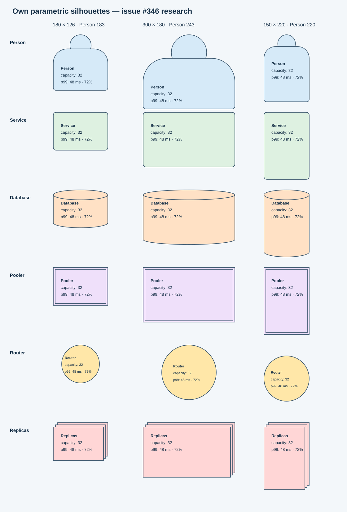

# S6: изображения блоков и отрисовка схемы

Дата: 2026-10-31. Исследование для [#346](https://github.com/ChernetsovNG/resilience-lab/issues/346), перед [#341](https://github.com/ChernetsovNG/resilience-lab/issues/341) и [#342](https://github.com/ChernetsovNG/resilience-lab/issues/342).

## Рекомендация

Сохранить DOM-узлы React Flow. Силуэт каждого типа вычислять по фактическим ширине и высоте узла и рисовать встроенным SVG позади HTML-содержимого. Значки оставить собственными, вынести в отдельные SVG-файлы с `currentColor`. Новая продуктовая зависимость для этого не нужна.

Это два разных вида графики. Силуэт должен приспосабливаться к полям, метрикам и размерам карточки, сохраняя круг головы, высоту крышки цилиндра и отступ двойной рамки. Маленький значок имеет постоянные пропорции и подходит для палитры и заголовка. Готовый набор пиктограмм решает вторую задачу, но не первую.

Из сторонних наборов ближе всего Lucide и Tabler Outline. Их можно рассматривать при отдельном пересмотре правила [web/AGENTS.md](../../web/AGENTS.md#картинки-и-значки), которое сейчас требует рисовать свои изображения. Выбор собственных SVG сохраняет это правило и внешность значков в #342. Логотипы облачных продуктов, Kafka, RabbitMQ и Redis не нужны для обозначения универсальных типов модели: роль показывают форма и подпись, технологию — текст.

## Исходное состояние и границы

Код проверен на `9dae6203d6bfca459b54ba7b250519561e3c4bc5`. В [концепции интерфейса](../product/2026-10-29-interface-concept.md#43-области) уже выбраны силуэты по типам, HTML-содержимое со встроенной правкой и общие отметки результатов. [Продуктовое видение](../product/2026-10-27-product-vision.md) предполагает расширение набора вычислимых блоков; [драйвер D2](../architecture/2026-10-27-target-architecture.md#11-решения-человека-2026-10-27) — отображение текущего уровня иерархии. Требование исследования о 5000 листьях не означает, что все листья обязательно должны одновременно оставаться подробными карточками.

- [BlockNode](../../web/src/canvas/BlockNode.tsx) совмещает HTML-поля, метрики, `Handle`, диагностические отметки и окраску загрузки. Силуэт задаётся CSS-классом; [BlockIcon](../../web/src/layout/BlockIcon.tsx) содержит SVG-разметку.
- [Canvas](../../web/src/canvas/Canvas.tsx) получает измерения размеров, использует их при размещении и сохраняет перемещения. Ручного изменения размера нет.
- [LayoutFile](../../core/src/main/kotlin/resiliencelab/core/document/Documents.kt) и [схема раскладки](../../schemas/layout.schema.json) содержат `schemaVersion: 1` и `positions` с `x/y`; размеры не сохраняются.
- Установлены React 19.3.1, React Flow 12.12.0 и Vite 8.3.5. Исследовательский прототип находится отдельно в [research/block-visuals](../../research/block-visuals/README.md). Код `web/`, `core/`, `apps/` не меняется.

Оценка узнаваемости ниже основана на форме символов и опубликованных правилах наборов. Пользовательское исследование и сравнение экранных читалок не проводились. Измерения прототипа описаны отдельно; их нельзя переносить на полный редактор без проверки.

## Нотации и библиотеки диаграмм

Нотация задаёт смысл элемента; лицензия конкретного SVG определяет право включить файл в приложение. Самостоятельно нарисованный цилиндр и скопированная иллюстрация стандарта имеют разное происхождение. Приведённые оценки GPLv3 относятся к проверенным условиям поставок, а не являются юридической гарантией.

| Источник | Покрытие типов и смысл | Стиль и малый размер | Поставка и условия включения |
|---|---|---|---|
| [C4](https://c4model.com/diagrams/notation) | Person, Software System и Container описывают роли и уровни. БД, очередь, pooler, router, cache и реплики требуют пояснений технологии/роли. C4 официально не привязан к нотации. | Подходящий ориентир для карточек с именем и типом; не готовый набор значков 16 px. | Свои простые формы допустимы как собственная реализация. Разрешение на копирование конкретных иллюстраций сайта из этого не следует. |
| [C4-PlantUML](https://github.com/plantuml-stdlib/C4-PlantUML) | Макросы `Person`, `System`, `Container`, `ContainerDb`, `ContainerQueue`; pooler/router/replicas/cache обозначаются дополнительной семантикой. У Person есть варианты представления, обязательного контура человека нет. | Person, карточка, цилиндр и очередь узнаваемы в диаграмме; уменьшение полной карточки до значка теряет подписи. | Макросы и собственные формы проекта: [MIT](https://github.com/plantuml-stdlib/C4-PlantUML/blob/master/LICENSE), с сохранением уведомления. Внешние sprites требуют своей проверки. Используем идею форм; исходники не переносим. |
| [UML 2.5.1](https://www.omg.org/spec/UML/2.5.1) | Actor на use-case диаграмме — внешняя роль, а не обязательно человек; deployment Node/Device/ExecutionEnvironment и Artifact — вычислительный ресурс и размещение. Сервис, БД, pooler, router, группа, очередь, кэш и зона потребуют стереотипов и легенды. | Actor прост, но куб deployment node и значок component перегружены для 16 px; единый набор `currentColor` стандарт не поставляет. | Официальная спецификация и её изображения защищены copyright; доступный PDF не является SVG-набором под GPL. [Условия OMG](https://www.omg.org/legal/). Для своих общеупотребительных форм не копируем artwork спецификации. |
| [ArchiMate](https://www.opengroup.org/archimate-forum/archimate-overview) | Application Component/Service, Node, Device, System Software и Grouping покрывают архитектурные роли и границы. Очередь, pooler, cache и replica group не дают готового словаря примитивов симуляции. | Угловые маркеры и многослойная нотация требуют обучения; различия мелких маркеров теряются. Монохромное изображение возможно. | Спецификация и официальные изображения не являются открытым пакетом SVG. [Лицензирование](https://www.opengroup.org/licensing-commercial-and-non-commercial) и [некоммерческая лицензия ArchiMate 4](https://www.opengroup.org/sites/default/files/contentimages/Licenses/ArchiMate4_NCLv.1_ff.pdf) ограничивают распространение Documentation. Отдельный [ArchiMate 101](https://archimate-community.pages.opengroup.org/workgroups/archimate-101/) опубликован сообществом под CC BY-SA 4.0; это другой источник, не нормативный стандарт. |
| [draw.io / diagrams.net](https://github.com/jgraph/drawio) | Общие shapes и библиотеки C4/UML/облачных продуктов покрывают большинство образов, но pooler и правила симуляции всё равно нужно определить. | Общие контуры могут быть единообразны; смешивание библиотек даёт разные толщины, цвета и пропорции. Полные stencils не рассчитаны как единый набор 16–24 px. | XML stencils, JS shapes и внешние библиотеки. [LICENSE кода](https://github.com/jgraph/drawio/blob/dev/LICENSE) — Apache-2.0; [README](https://github.com/jgraph/drawio/blob/dev/README.md#license) отдельно задаёт условия icon sets/stencils/templates и отмечает third-party copyright. Безусловно считать всю библиотеку Apache/GPL-совместимой нельзя. |
| [Excalidraw libraries](https://libraries.excalidraw.com/) | Общие архитектурные и инфраструктурные картинки зависят от выбранной библиотеки; единого обязательного словаря наших типов нет. | Рукописный стиль и разная детализация библиотек мешают единству; малые пиктограммы требуют упрощения. | `.excalidrawlib` и экспорт SVG. [Приложение MIT](https://github.com/excalidraw/excalidraw/blob/master/LICENSE), [официальный каталог библиотек MIT](https://github.com/excalidraw/excalidraw-libraries/blob/main/LICENSE). Нужны уведомления и проверка происхождения выбранного рисунка; отдельный найденный в сети файл не получает лицензию каталога автоматически. |

Для C4 важнее явно подписать тип и технологию, чем воспроизвести чужой stencil. Person подходит нынешнему клиенту по принятому эталону [person.svg](../design/person.svg), но легенда должна объяснять, что блок генерирует запросы. Это может быть программный клиент; силуэт сам по себе не задаёт семантику человека.

UML разрешает реализацию ПО по спецификации; это не общее разрешение извлекать её иллюстрации. Для ArchiMate сравнение общих обозначений опирается на открытый community handbook: актуальная нормативная спецификация 4 требует входа, её точные определения здесь не проверялись. У иллюстраций handbook своя CC BY-SA 4.0 с атрибуцией и ShareAlike; перенос таких рисунков потребовал бы отдельного выбора условий распространения. Ни рисунки стандарта, ни handbook в репозиторий не копируются.

## Наборы значков

`currentColor` ниже означает возможность наследовать цвет от HTML при встроенном SVG или шрифте. SVG, подключённый через ``, загружается как отдельное изображение: CSS-переменные родительского элемента в него не передаются. Облачный цветной SVG технически можно переработать, но это меняет artwork и может нарушить условия его использования.

| Набор | Наши текущие и будущие типы | Единство и 16–24 px | Поставка; лицензия и атрибуция |
|---|---|---|---|
| [AWS Architecture Icons](https://aws.amazon.com/architecture/icons/) | Клиент, compute, БД, маршрутизация/LB, группы, очередь, cache, внешние сервисы и зоны представлены AWS-продуктами; общего connection pooler нет. | Цветные категории и продуктовые детали; есть варианты малых размеров, но это язык AWS, а не общий монохромный словарь. | Официальный ZIP SVG/PNG. Специальное разрешение создавать диаграммы/материалы; свободный LICENSE в проверенном ZIP не найден. [Условия AWS](https://aws.amazon.com/terms/). GPL-совместимость как встраиваемого набора не установлена; не копировать. |
| [Azure architecture icons](https://learn.microsoft.com/en-us/azure/architecture/icons/) | Azure compute/SQL/Service Bus/Redis/LB/regions; клиент и внешние системы через общие символы, pooler и универсальная группа реплик требуют своего обозначения. | Цветные продуктовые символы; контур и толщина не едины с обычными значками приложения. | SVG. На той же странице полный раздел Icon terms: использование в архитектурных диаграммах, обучении и документации; остальные права сохранены, искажение и обозначение собственного продукта запрещены. Это не свободная GPL-совместимая библиотека для произвольных типов. |
| [Google Cloud icons](https://cloud.google.com/icons) | Compute, БД, messaging, cache, network/LB и зоны; отдельные продукты разделяют знак категории. Клиент/pooler/replicas требуют дополнения. | Цветные продуктовые/категорийные знаки, без единого `currentColor`-профиля. Категория может не различать БД и cache. | SVG/PNG ZIP. Свободный LICENSE на странице и в проверенных архивах не найден. [Условия бренда](https://about.google/brand-resource-center/guidance/). Лицензия примеров кода Google не лицензирует эти изображения; включение в GPL-приложение не подтверждено условиями поставки. |
| [Kubernetes icons](https://github.com/kubernetes/community/blob/main/icons/README.md) | Pod/Service/ReplicaSet/Ingress и границы кластера; хорошо для реальных объектов Kubernetes. БД/pooler/cache/broker не являются соответствующими объектами этого каталога. | Единые шестиугольники, версии с подписями и без; подписи и мелкие детали плохо подходят 16 px. | SVG/PNG. Apache-2.0 **или** CC BY 4.0; проще выбрать [Apache-2.0](https://github.com/kubernetes/community/blob/main/LICENSE), сохранить уведомления/NOTICE при наличии, отметить изменения. Совместим с GPLv3 на этих условиях. [Права на логотип](https://github.com/kubernetes/kubernetes/blob/master/logo/usage_guidelines.md) отдельные. |
| [Lucide](https://lucide.dev/) | User/Server/Database/Network/Layers/ListOrdered/Globe/Building2 дают основу для клиента, сервиса, БД, маршрутизации, группы, очереди, внешней системы и зоны. Pooler/cache/LB требуют подписи, отдельного общеупотребительного символа нет. | Контур 2 на сетке 24, `currentColor`. Простой знак пригоден для 16–24 px после проверки; плотные варианты на 16 px хуже. | SVG, npm `lucide-react`. [Полный LICENSE](https://github.com/lucide-icons/lucide/blob/main/LICENSE): ISC и MIT-уведомления для Feather-derived рисунков; сохранить оба. GPLv3-совместим. [Брендовые логотипы исключены](https://lucide.dev/brand-logo-statement). |
| [Tabler Icons](https://docs.tabler.io/icons) | Общие user/server/database/network/layers/queue/cache/building и более широкий инфраструктурный каталог; семантику pooler/LB/replicas всё равно определяет проект. Есть отдельные brand icons. | Outline 24×24, stroke 2, `currentColor`; не смешивать с Filled. Сложные знаки требуют проверки в 16 px. | SVG, npm `@tabler/icons-react`; [MIT](https://github.com/tabler/tabler-icons/blob/main/LICENSE), сохранить copyright/permission notice. GPLv3-совместим; MIT не отменяет права на бренды. |
| [Material Symbols](https://developers.google.com/fonts/docs/material_symbols) | Person/DNS/Storage/Hub/AccountTree/Memory/Public и границы дают общие образы всех ролей; pooler/broker/replicas не получают точную семантику без подписи. | Outlined/Rounded/Sharp, fill/weight/grade/optical size. Выбирать один профиль; `opsz` 20–48, 16 px вне документированного диапазона. | Официальные SVG/PNG и variable font; [Apache-2.0](https://github.com/google/material-design-icons/blob/master/LICENSE), сохранить лицензию/уведомления и отметить изменения. GPLv3-совместим. npm `material-symbols` — сторонняя поставка, не официальный React-пакет Google. |
| [Phosphor](https://phosphoricons.com/) | Общие символы людей, вычислений, БД, сети, стопки, очереди, памяти, внешней системы и здания; pooler, routing policy и replica group требуют легенды. | Шесть весов, `currentColor`; выбрать один вес. Thin и детальные знаки требуют отдельной проверки в 16 px. | SVG, npm `@phosphor-icons/react`; [MIT core](https://github.com/phosphor-icons/core/blob/main/LICENSE) и [MIT React](https://github.com/phosphor-icons/react/blob/master/LICENSE), сохранить уведомления. GPLv3-совместим. |
| [Font Awesome Free](https://github.com/FortAwesome/Font-Awesome) | Общие символы пользователя, сервера, БД, сети, слоёв, памяти, внешней системы и здания; очередь и pooler обычно составные образы. Наличие Free не означает наличие Pro-значка. | Solid монохромен и читаем при малом размере; это заливка, а не контур. Brands и Regular имеют другой рисунок. | SVG/JS и webfonts. [LICENSE](https://github.com/FortAwesome/Font-Awesome/blob/7.x/LICENSE.txt): изображения CC BY 4.0, шрифты OFL 1.1, остальной код MIT. SVG допустим с GPLv3 при атрибуции/ссылке на лицензию/отметке изменений; шрифт можно поставлять вместе с приложением, сохранив OFL, не перелицензируя сам шрифт в GPL. После оптимизации нельзя потерять attribution. |
| [Heroicons](https://github.com/tailwindlabs/heroicons) | User/Server/ServerStack/CircleStack/QueueList/Globe и здания; специализированных pooler/router/cache меньше. | Отдельные Solid 16/20/24 и Outline 24. Хороший ориентир для маленьких знаков, но менее полный инфраструктурный словарь. | SVG, React/Vue; [MIT](https://github.com/tailwindlabs/heroicons/blob/master/LICENSE), сохранить уведомления. GPLv3-совместим. |

Условия MIT/ISC/Apache-2.0 не требуют перелицензировать upstream-файлы в GPL: сохраняются их лицензии и уведомления, а комбинированное приложение распространяется с соблюдением GPLv3. Для Apache важны NOTICE при наличии и отметки изменений; для CC BY — авторство, лицензия и изменения. Основания: [FSF о лицензиях](https://www.gnu.org/licenses/license-list.en.html), [Apache о совместимости с GPLv3](https://www.apache.org/licenses/GPL-compatibility.html), [CC BY 4.0](https://creativecommons.org/licenses/by/4.0/legalcode.en). Корневой `LICENSE` проекта не заменяет эти обязанности. Для товарных знаков нужна отдельная проверка.

### Масштаб и размер поставки

При масштабе сцены 5% знак 16 px занимает 0,8 экранного CSS-пикселя, 24 px — 1,2 px. Выбор библиотеки этого не исправляет. На обзорном масштабе полезны границы групп, силуэты и крупные отметки состояния; текст и подробные значки нужны при приближении. SVG сохраняет геометрию при увеличении, но не гарантирует различимость деталей при уменьшении.

Проверенные метаданные npm на 2026-10-31:

| Пакет | Версия | Лицензия | Распакованная поставка, байт |
|---|---|---|---:|
| [lucide-react](https://registry.npmjs.org/lucide-react/1.66.0) | 1.66.0 | ISC + MIT для части рисунков | 38 230 524 |
| [@tabler/icons-react](https://registry.npmjs.org/@tabler%2Ficons-react/3.50.0) | 3.50.0 | MIT | 17 565 058 |
| [@phosphor-icons/react](https://registry.npmjs.org/@phosphor-icons%2Freact/2.1.10) | 2.1.10 | MIT | 33 027 417 |
| [@fortawesome/free-solid-svg-icons](https://registry.npmjs.org/@fortawesome%2Ffree-solid-svg-icons/7.3.1) | 7.3.1 | CC BY 4.0 + MIT | 5 117 091 |
| [@heroicons/react](https://registry.npmjs.org/@heroicons%2Freact/2.2.0) | 2.2.0 | MIT | 3 688 492 |

Это размер установки, а не добавка к загружаемому JavaScript. Для выбранного подмножества она зависит от импорта и сборщика. Продуктовая зависимость не рекомендуется: несколько уже существующих собственных значков не оправдывают изменение словаря, лицензирования и способа поставки. Если набор понадобится позже, измерять разницу production-сборок с точным списком импортов; не сравнивать каталоги по размеру npm-архива.

## Способы отрисовки

Сравниваются три независимых решения: геометрия большого блока, доставка маленькой пиктограммы и движок всей сцены. React-компонент, файл и `<symbol>` могут содержать один и тот же SVG; изменение упаковки не исправляет растяжение силуэта.

| Способ | Размер и цвет | React Flow, выбор, доступность | Экспорт и зависимости |
|---|---|---|---|
| Параметрический SVG `(w, h)` | Круг головы пересчитывается из одного диаметра, крышка/отступы ограничены независимо от растяжения тела. Встроенный SVG наследует CSS-переменные. | HTML-поля и `Handle` остаются; SVG декоративный, `pointer-events: none`. Выбор/отказы/переопределения остаются отдельными слоями. | Чистую геометрию можно повторно использовать при экспорте. HTML-текст и поля надо отдельно преобразовать. Зависимостей нет. |
| XML stencil по образцу mxGraph | Фиксированные и растягиваемые части выразимы, но `aspect="variable"` сам по себе растягивает обе оси, а `fixed` сохраняет пропорции всей формы. Круг головы и постоянная крышка требуют дополнительных правил. | После интерпретации в SVG совместим с DOM-узлом; нужен контракт области текста и портов. Доступность обеспечивает обёртка. | Потребуются интерпретатор, поддерживаемое подмножество XML и правила экспорта. Для шести форм это больше кода, чем функции геометрии. Реальный mxGraph не подключается. |
| Статический SVG целой формы | `preserveAspectRatio="none"` растягивает круг в эллипс. `meet` сохраняет пропорции, но оставляет свободное место и не расширяет область содержимого. Inline можно перекрасить; `` не наследует CSS-переменные страницы. | Нужна отдельная геометрия портов/текста, иначе она расходится с рисунком. Для маленького значка постоянных пропорций подходит. | Простой перенос изображения; текст HTML отдельно. Свои файлы не требуют зависимости. |
| Значок React-компонентом | Фиксированный `viewBox`, размер 16–24 px, `currentColor`; силуэт карточки не заменяет. | Обычный SVG внутри узла; удобны props, но для собственного файла потребуется сборочное преобразование или обёртка. Имя задаётся смыслом действия/типа. | SVG переносим; зависимость набора и её уведомления либо собственные компоненты. Tree shaking надо проверять production-сборкой. |
| SVG `<symbol>` / `<use>` | Общая геометрия, цвет наследуется; каждый экземпляр имеет своё имя в обёртке. Использовать для значков, не для растягиваемой карточки. | Меньше явной повторяющейся разметки, но браузер всё равно создаёт экземпляры для отрисовки. Нельзя заранее обещать выигрыш FPS. | В standalone SVG надо включить используемые `<defs>` и уникализировать id. Один локальный sprite можно собрать из своих файлов; новая библиотека не нужна. |
| Шрифт значков | `color` наследуется; glyph имеет фиксированные пропорции. Загрузка, baseline и fallback влияют на вид. Составные многоцветные статусы неудобны. | Кодовая точка не служит доступным именем. Декоративный glyph скрывается, действие именуется на кнопке. Шрифт не решает геометрию портов. | Нужно встраивание шрифта либо преобразование glyph в path; иначе экспорт зависит от окружения. Отдельный font build/subset и лицензия. |
| Canvas 2D | Произвольная геометрия; CSS-переменные надо читать и передавать в renderer. Плотность пикселей/перерисовка определяют чёткость. | DOM-узлы React Flow исчезают. Hit testing, фокус, поля ввода, порты, selection и доступность придётся строить заново или добавлять HTML-overlay. | PNG естественен; SVG требует отдельного сериализатора модели. API браузера без пакета, но существенная новая реализация редактора. |
| WebGL | Геометрия/атлас на GPU, цвета через uniforms/attributes. Текст и качество атласа — отдельная задача. | Те же потери DOM и поведения React Flow, плюс контекст GPU и ресурсы. HTML-overlay сохраняет часть стоимости DOM. | PNG через canvas; SVG отдельным renderer. WebGL API не требует пакета, но нуждается в шейдерах, текстовых атласах и обработке context loss. |

Основания: [SVG `viewBox` / `preserveAspectRatio`](https://www.w3.org/TR/SVG/latest/coords.html#PreserveAspectRatioAttribute), [SVG `<use>` и наследование](https://www.w3.org/TR/SVG/latest/struct.html#UseElement), [формат stencils](https://www.drawio.com/docs/manual/shapes/shape-complex-create-edit/), [Shapes and Stencils](https://github.com/jgraph/drawio/wiki/Shapes-and-Stencils), [React Flow custom nodes](https://reactflow.dev/learn/customization/custom-nodes), [оптимизация React Flow](https://reactflow.dev/learn/advanced-use/performance).

Для mxGraph нужна проверка точной версии: текущий [master/LICENSE](https://github.com/jgraph/mxgraph/blob/master/LICENSE) содержит дополнительное ограничение интеграции с Atlassian. Он не равен чистой Apache-2.0. Собственный минимальный XML-прототип здесь проверяет стоимость представления, не совместимость со всеми stencils draw.io и не производительность настоящего mxGraph.

Для #342 подходит штатный [импорт Vite `?raw`](https://vite.dev/guide/assets.html#importing-asset-as-string) с общей обёрткой для **локальных доверенных** SVG. Если вставка строки использует `dangerouslySetInnerHTML`, в этот путь не попадают файлы модели, URL или пользовательский SVG. Альтернатива — локальный sprite с `<use>`. Добавлять runtime XML-парсер или SVGR только ради переноса существующих значков не требуется.

Декоративная форма скрыта от экранной читалки. Кнопка палитры получает доступное имя типа; значок рядом с тем же текстом не озвучивается повторно. Если значок один передаёт состояние, имя включает состояние. Значение результата показывается текстом: одна окраска недостаточна. Это соответствует [WAI о декоративных изображениях](https://www.w3.org/WAI/tutorials/images/decorative/). Будущий экспорт фиксирует вычисленные цвета и выбранный момент результатов; интерактивные поля превращаются в текст. Снимок HTML через `foreignObject` и чистый переносимый SVG — разные форматы экспорта.

Экспорт всей модели также нельзя строить только по DOM видимого фрагмента при включённом отсечении невидимых узлов: нужен отдельный полный проход модели. [Пример PNG у React Flow](https://reactflow.dev/examples/misc/download-image) использует `html-to-image`; это вариант для исследования будущего экспорта, не зависимость текущей рекомендации. Код [Shapes example](https://reactflow.dev/examples/nodes/shapes) имеет xyflow Pro License: MIT основного пакета React Flow не разрешает копировать этот пример как MIT.

## Измерения прототипа

Прототип и команды находятся в [research/block-visuals](../../research/block-visuals/README.md). [Собственная SVG-иллюстрация](../../research/block-visuals/own-silhouettes.svg) и браузерная галерея показывают шесть форм в обычном, широком и высоком размере; это исследовательские образцы, а не готовая реализация #341.



Воспроизведение из корня репозитория, Node.js 26:

```sh
cd research/block-visuals
npm ci
npx playwright install chromium
npm run build
npm run bench
```

Runner поднимает собственный сервер на `127.0.0.1:15246` и завершает его вместе с браузером. Для другого порта: `BENCH_PORT=15247 npm run bench`. Команда перезаписывает [сырые измерения](../../research/block-visuals/results/raw.json) и [сводку](../../research/block-visuals/results/summary.json); перед повторением сохраните нужную копию результатов.

Окружение измерения: Apple M4 Pro, 14 логических CPU, 48 GiB RAM, macOS/Darwin 25.6 arm64; Node.js 26.0.0; Playwright 1.64.1, Chromium 156.0.8078.4 в headless-режиме, viewport 1280×900, DPR 1. WebGL сообщает **ANGLE / SwiftShader**, программный renderer. Версии установленных пакетов и SHA-256 исходников сохранены в метаданных. Поле `executable` получено от `chromium.executablePath()` и описывает установленный Chromium; стандартный headless-запуск Playwright использует поставляемый headless shell. Фактическую версию браузера сообщает `browser.version()`.

Нагрузка — детерминированная сетка 50, 500 или 5000 узлов шести типов, по два порта, `N−1` прямых рёбер, заголовок, поле параметра, строка метрики, шесть заливок и отметки состояния. DOM-варианты используют настоящий React Flow и редактируемый input. Варианты значков рисуют обычную карточку; варианты силуэтов — контур типа. Поэтому разницу этих двух групп нельзя приписывать одной упаковке SVG. React-компонент и `<symbol>` используют одинаковые собственные пути; шрифт Font Awesome Free 7.3.1 содержит лишь похожие по смыслу глифы.

Протокол включает три повторения каждого из 27 сочетаний, порядок циклически сдвигается. В каждом новый browser context, 2 секунды прогрева и 4 секунды измерения приближения/отдаления `0.05–2–0.05` вокруг занятого центра сцены. Браузер и файловый кэш ОС остаются прогретыми. Начальная готовность измеряется от bootstrap перед динамическим импортом общего production bundle до инициализации узлов, готовности шрифтов и двух `requestAnimationFrame`. Это время до возможности отрисовать сцену, а не timestamp фактического compositor paint. Общий bundle загружает React Flow также для canvas/WebGL, поэтому их старт не равен минимальному старту отдельного raster-приложения.

FPS вычислен по интервалам `requestAnimationFrame`; он характеризует доступность главного потока, а не доказанное число показанных монитором кадров. Сохраняются все интервалы, p95, фактически достигнутый zoom, число видимых узлов и количество DOM-элементов. Скриншоты и дополнительная проверка culling при zoom 2 выполняются вне таймера. Значения таблицы — медианы трёх повторений; доверительные интервалы по такой выборке не оцениваются.

В каждой ячейке: **готовность, мс / FPS / p95 интервала кадра, мс**.

| Вариант | 50 узлов | 500 узлов | 5000 узлов |
|---|---:|---:|---:|
| Параметрический SVG | 64.7 / 60.0 / 16.7 | 130.9 / 60.0 / 16.8 | 874.0 / 24.3 / 66.6 |
| Собственный XML-поднабор | 64.6 / 60.0 / 16.8 | 132.6 / 60.0 / 16.7 | 915.9 / 23.7 / 66.7 |
| Фиксированный SVG, растяжение | 65.3 / 60.0 / 16.7 | 149.0 / 60.0 / 16.7 | 898.0 / 23.3 / 66.6 |
| Значок React SVG | 65.9 / 60.0 / 16.7 | 146.2 / 60.0 / 16.7 | 929.6 / 21.8 / 50.1 |
| Значок SVG symbol/use | 65.1 / 60.0 / 16.7 | 130.8 / 60.0 / 16.7 | 1022.3 / 20.9 / 66.7 |
| Шрифт значков | 81.5 / 60.0 / 16.7 | 148.5 / 60.0 / 16.7 | 1065.3 / 23.0 / 83.3 |
| Canvas2D, атлас | 34.9 / 60.0 / 16.8 | 34.9 / 60.0 / 16.8 | 45.1 / 60.0 / 16.8 |
| WebGL, атлас / SwiftShader | 72.2 / 60.0 / 16.7 | 81.3 / 59.8 / 16.8 | 114.9 / 58.0 / 16.8 |
| Параметрический SVG + culling | 64.9 / 60.0 / 16.8 | 131.3 / 60.0 / 16.7 | 968.1 / 40.6 / 66.6 |

На 50 и 500 узлах большинство вариантов упирается в потолок rAF около 60 Hz; по этим значениям нельзя выбрать самый быстрый набор значков. При 5000 узлах три способа построения силуэта дают 23,3–24,3 FPS. Здесь параметрический SVG выбирается за контроль геометрии; замер не показывает существенного выигрыша статического SVG или XML.

Обычная сцена с параметрическими фигурами содержит 80 871 DOM-элемент. `onlyRenderVisibleElements` поднимает медиану до 40,6 FPS, но p95 остаётся 66,6 ms. На начальном масштабе 5% все 5000 узлов видны, поэтому старт с culling не ускорился: 968,1 ms против 874,0 ms. В отдельной проверке при zoom 2 действительно остаются 9 смонтированных узлов и 216 DOM-элементов. Это аргумент измерять culling вместе с иерархией и упрощением подробностей на обзорном масштабе; один флаг ещё не обеспечивает плавные 60 FPS для всей траектории.

У React SVG и symbol/use на 5000 узлах соответственно 86 705 и 81 705 DOM-элементов. Меньше явной разметки не дало выигрыша FPS в этой нагрузке. Три повторения не позволяют объявить sprite универсально медленнее; оснований вводить его как обязательную оптимизацию #342 тоже нет. Во всех прогонах масштаб достигал как минимум 1,9974, почти заданных 200%.

Canvas2D и WebGL используют атлас всего из шести карточек с повторяющимися подписями. В них нет editing, hit testing, drag/connect, accessibility-дерева и состояния React Flow. Это намеренно оптимистичные эскизы отрисовки, а не редакторы с равными возможностями. Тысячи уникальных названий/метрик, обновление результатов, память, Safari/Firefox, аппаратный GPU и мобильные устройства не измерялись.

## Предлагаемый словарь собственных изображений

Все рисунки ниже создаются для проекта и распространяются вместе с ним по GPLv3. Источники в таблице задают смысл/ориентир, а не разрешение копировать сторонний файл. Значок один и тот же в палитре и заголовке; надпись уточняет роль.

| Тип | Силуэт блока | Значок и смысл | Основание |
|---|---|---|---|
| Клиент | Person: круг, частично перекрытый плечами карточки | Собственный простой человек; подпись «Клиент» | [Эталон проекта](../design/person.svg), Person как ориентир C4-PlantUML |
| Сервис | Скруглённая карточка | Существующий собственный знак сервиса | Концепция интерфейса; не логотип конкретного runtime |
| БД | Цилиндр, крышка постоянной высоты | Собственный цилиндр | `ContainerDb` как ориентир; текст технологии при необходимости |
| Пулер | Карточка с двойной рамкой и постоянным отступом | Существующий собственный знак пулера | Договорённость проекта; не заявляем стандартный символ C4/UML |
| Маршрутизатор | Круг, вписанный в меньшую сторону узла | Собственный веер выходов | Концепция интерфейса; не физический Wi-Fi router |
| Группа реплик | Основная карточка и две смещённые задние кромки | Стопка и `×N` | Концепция интерфейса; число не заменяется N DOM-карточками |
| Очередь / брокер | Карточка с небольшим знаком очереди; форму согласовать при добавлении вычислимого типа | Собственная последовательность элементов; подпись Queue/Broker, Kafka/RabbitMQ текстом | `ContainerQueue` как ориентир; очередь и брокер не тождественны |
| Кэш | Карточка хранилища с отдельным знаком кэша | Собственный знак хранилища с коротким маркером ускорения, подпись «Кэш» | Легенда проекта; Redis текстом, не логотип |
| Внешняя система | Обычная карточка с явной подписью роли | Собственный контур системы/глобуса | Software System как ориентир C4; не смешивать внешность с состоянием отказа |
| Балансировщик | Та же семья круга/веера, что у маршрутизатора | Веер и подпись LB/политики | Общая маршрутизация; отдельная форма только при новой семантике блока |
| Зона / дата-центр | Группирующая рамка с заголовком, содержащая узлы | Необязательный собственный знак здания | Граница размещения, не вычислимый сервис; будущая иерархия/контейнер |

Для будущих типов это рекомендация визуального языка, а не добавление блоков в каталог или изменение модельной семантики. Подписи и легенда обязательны там, где общеупотребительного однозначного символа нет.

## Что передать в #341 и #342

В #341 сохранить выбранный модуль геометрии без новых зависимостей. Результат функции должен включать замкнутый контур заливки, линии деталей, прямоугольник содержимого и координаты портов. Контур головы и плеч рисуется без видимого шва/зазора; диаметр головы `min(0.38w, 0.35h)` применяется к обеим осям. Крышка БД около 16 px и отступ пулера измеряются в координатах модели, а не экранных пикселях. Для слишком маленького узла нужны минимальные размеры по содержимому, иначе геометрически корректная форма всё равно наложится на текст.

Общие состояния остаются у HTML-узла: `--node-fill` и `--node-stroke` передают цвет в SVG; выбор, пунктир переопределения, отказ и насыщение не заменяют друг друга. SVG не перехватывает pointer events. Порты находятся на видимой границе, а не автоматически на середине bounding box. После изменения расположения портов React Flow должен перечитать их геометрию. Проверить узкий/обычный/высокий размер, появление строк результатов и длинное имя. Эталон Person уже есть; группа реплик тоже входит в общий контракт, даже если её контур останется простым.

В #342 сохранить внешний вид и вынести существующие значки по одному файлу в `web/src/assets/icons/`. Общая обёртка задаёт размер, цвет и доступное имя; у файла только `viewBox` и геометрия с `currentColor`. Проверить все типы каталога и запасной значок. Перерисовка набора под Lucide, импорт брендовых логотипов и генератор шрифтов в этот перенос не входят.

## Ручное изменение размера: отдельная задача

Штатный [NodeResizer](https://reactflow.dev/api-reference/components/node-resizer) уже входит в React Flow: ручки/линии, min/max, `keepAspectRatio`, `autoScale`, callbacks. Он меняет размер узла, но сам не сохраняет раскладку и не реализует историю редактора. В установленной версии 12.12.0 `getNodeInlineStyleDimensions` читает `node.width/height` либо `style.width/height`; измерения хранятся в `measured`. Это согласуется с [описанием перехода на v12](https://reactflow.dev/learn/troubleshooting/migrate-to-v12#2-node-measured-attribute-for-measured-width-and-height). На общей странице Node встречается указание не задавать размеры напрямую; при реализации опираться на установленную версию и проверять весь цикл изменения.

Потребуются следующие связанные изменения:

1. **Контракт раскладки.** Предложение: новая версия раскладки с отдельным необязательным словарём `sizes` по тому же пути блока, пары `width/height` в координатах модели. Отсутствие записи означает автоматический размер. Хранить только пользовательское решение; не записывать каждое измерение DOM. Значения конечные, положительные, с ограничениями содержимого. Это предложение формата, а не уже принятый контракт.
2. **Форматы и API.** Поднять версию раскладки с 1 до 2, обновить типы, кодек, JSON Schema, примеры и фикстуры, генерацию OpenAPI/клиентских типов при затрагивании контракта. По текущему правилу проекта старую версию отвергать понятной ошибкой; миграцию не добавлять. Версия модели и результатов сама по себе от resize не меняется.
3. **Редактор и история.** Временный размер во время жеста, одна команда истории при его завершении. При растяжении за верхнюю/левую ручку одновременно меняются позиция и размер: Undo/Redo должен восстановить их вместе. Сохранение, открытие, импорт/экспорт и «Сохранить как» должны сохранять размеры. Нужен сброс к автоматическому размеру.
4. **Геометрия.** Пересчитывать фигуру, область текста и порты; обновлять внутренние измерения React Flow. `keepAspectRatio` для всей карточки не заменяет правило круглой головы. Для маршрутизатора можно сохранять квадратную область либо вписывать круг в доступный прямоугольник; выбрать один контракт и проверить порты.
5. **Взаимодействие.** Ручки видны у выбранного узла на Model; на странице варианта структура остаётся недоступна. Минимум зависит от полей и метрик; при появлении результатов нельзя молча обрезать содержимое. Помимо мыши нужен доступный способ задать/сбросить размер с клавиатуры. Проверить zoom 5–200%, zoom-independent сохранение, snap и изменение контейнера в будущей иерархии.

Это отдельное изменение формата, редактора и API с интеграционными проверками. Для #341 достаточно пересчёта по фактическому размеру; #342 от хранения размеров не зависит. Переход на canvas/WebGL для resize не требуется.
